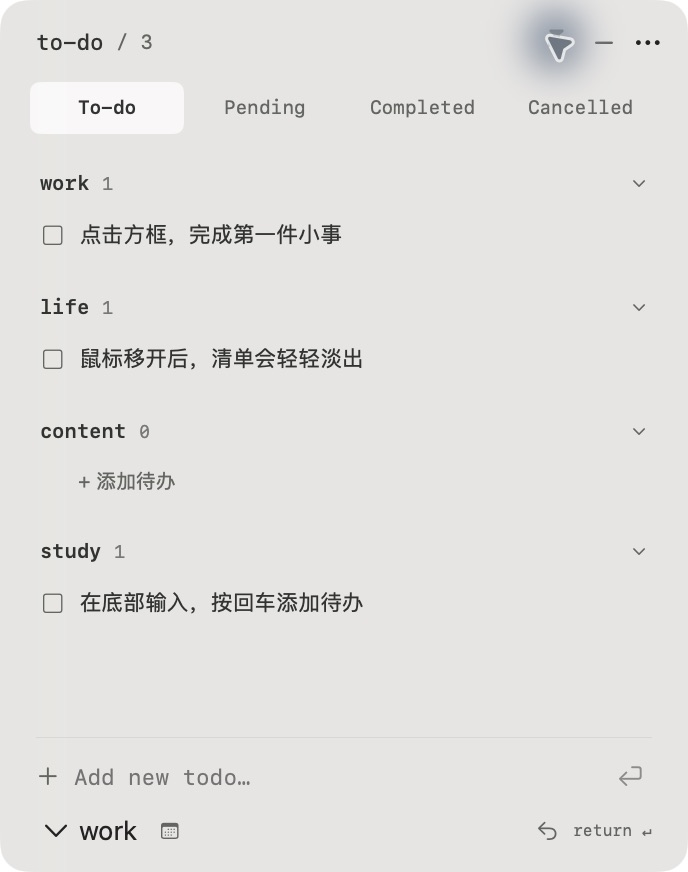

# 常在待办 · At a Glance

一个原生 Mac 桌面常驻待办工具，参考视频中的小型半透明清单制作。SwiftUI + AppKit 实现，无需账号和第三方运行时。



## 功能

- 半透明悬浮窗口、空闲淡出、图钉保持清晰，可选离开后收起。
- To-do、Pending、Completed、Cancelled 四种状态。
- 分类折叠、快速录入、编辑、完成、短截止日期与逾期标记。
- 本地自动保存、撤销、JSON 备份导入导出。
- 菜单栏常驻、可选登录启动，无 Dock 图标。
- 本地命令和 `ataglance://add` 深链，支持从具备本机执行能力的 AI 助手添加任务。

## 使用

从 [Releases](https://github.com/Alan0124/at-a-glance/releases) 下载 `At-a-Glance-Mac.zip` 并解压，双击应用。菜单栏图标左键显示或隐藏清单，右键打开设置、备份与退出菜单。

当前构建适用于 Apple 芯片 Mac，最低 macOS 13。应用采用本地 ad-hoc 签名，未做 Apple 公证。

[完整使用说明](使用说明.md) · [AI 接入说明](源码/AI接入说明.md)

## 从源码构建

需要 macOS 和 Xcode Command Line Tools（`xcode-select --install`）。在仓库根目录运行：

```sh
./源码/build.sh
```

脚本在仓库根目录生成 `常在待办.app` 与 `常在待办-Mac.zip`；上一次构建保存在 `源码/.build/`。生成的应用、压缩包和编译缓存不纳入 Git。

```sh
./源码/todo add '完成报告' --category work
./源码/todo add '买咖啡' --category life --due 2026-10-28
```

`todo` 会定位本仓库根目录的应用，因此调用前须先构建。如果仅下载 Release，直接使用应用界面即可。

## 验证

```sh
./源码/test-models.sh
./源码/test-automation.sh
./源码/test-panel.sh
```

模型测试包含 115 项行为断言；深链解析测试包含 29 项断言，并检查 CLI 编码及非法输入。实测覆盖添加、日期编辑、完成与筛选、删除、小条恢复、退出重开持久化及本地 CLI 添加。窗口拖动、跨屏、悬停恢复和自动收起的完整动态仍有验证限制，见 [审查记录](源码/.impeccable/review/review.md)。

## 数据

清单保存在 `~/Library/Application Support/AtAGlance/`，不在仓库中。没有云同步、系统通知或 Apple 提醒事项集成。

## 项目结构

```text
源码/Sources/        应用与数据模型
源码/Tests/          隔离行为测试
源码/Resources/      应用信息、图标与图标生成脚本
源码/build.sh        构建及打包
源码/todo            本地添加命令
源码/DESIGN.md       设计记录
使用说明.md          详细操作与数据恢复
```
